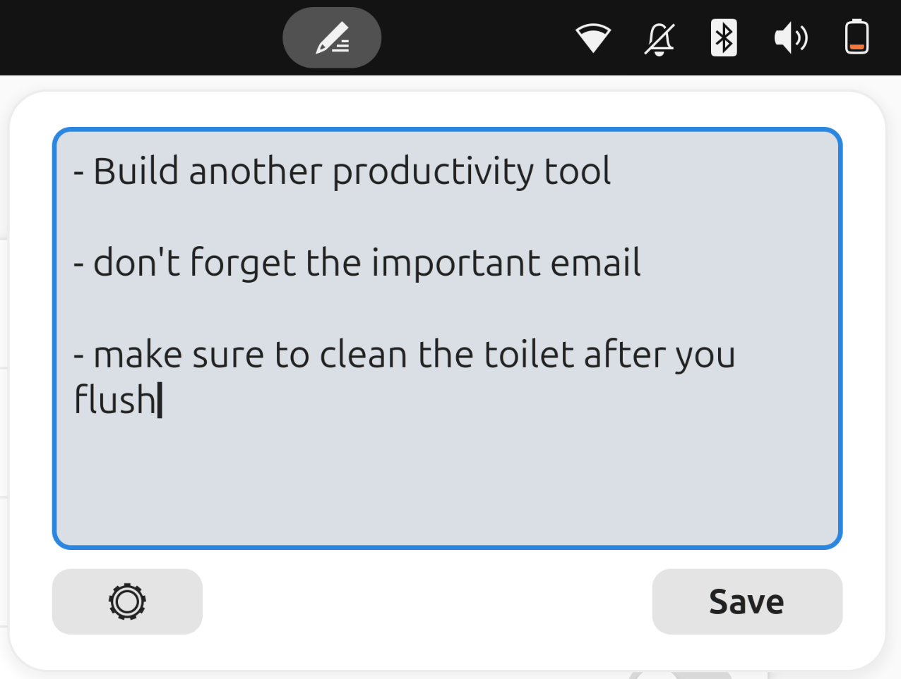

# Note Concat

A minimal GNOME Shell 50 extension for capturing thoughts and appending them to a local Markdown file without losing focus on your current task.



## Motivation

Note Concat is inspired by **distractibility delay**, a technique used in cognitive behavioural therapy for ADHD [[1]](https://pmc.ncbi.nlm.nih.gov/articles/PMC3874265/), and research on **cognitive offloading** [[2]](https://doi.org/10.1016/j.tics.2016.07.002).

> Write down distracting thoughts instead of acting on them. Return to your current task and review them later.

## Installation

**GNOME Extensions:** Link coming soon.
<!-- Replace with the Note Concat extension page once published. -->

### Manual installation

[Download the latest release ZIP](https://github.com/FreGeh/gnome-note-concat/releases/latest/download/note-concat@fregeh.shell-extension.zip) or browse [all releases](https://github.com/FreGeh/gnome-note-concat/releases).

Install the downloaded ZIP from its directory:

```sh
gnome-extensions install --force note-concat@fregeh.shell-extension.zip
```

Enable **Note Concat** in Extensions. If it does not appear, log out and back in first.

### Build from source

Alternatively, run the following commands in the repository directory:

```sh
gnome-extensions pack --force --extra-source=append.js --extra-source=LICENSE .
gnome-extensions install --force note-concat@fregeh.shell-extension.zip
```

Enable **Note Concat** in Extensions. If it does not appear, log out and back in first.

## Usage

Click the pencil icon in the top panel to write a note. **Save** or **Ctrl+Enter** appends it to `~/Notes/inbox.md` by default.

The gear button opens settings for the destination, font, editor size and automatic saving. By default, dismissing the popup keeps the draft, while **Save on session end** attempts to append it when locking, suspending or logging out. Enable **Save on popup close** if you prefer to append on every dismissal.

Unsaved drafts are kept privately on your device for recovery after an interrupted session. If a previous save could not be confirmed, check the destination before retrying.

## License

GPL-2.0-or-later. See [LICENSE](LICENSE).

## References

1. Sprich et al. (2010). [Description and Demonstration of CBT for ADHD in Adults](https://pmc.ncbi.nlm.nih.gov/articles/PMC3874265/). *Cognitive and Behavioral Practice*, 17(1), 9–15.
2. Risko & Gilbert (2016). [Cognitive Offloading](https://doi.org/10.1016/j.tics.2016.07.002). *Trends in Cognitive Sciences*, 20(9), 676–688.
