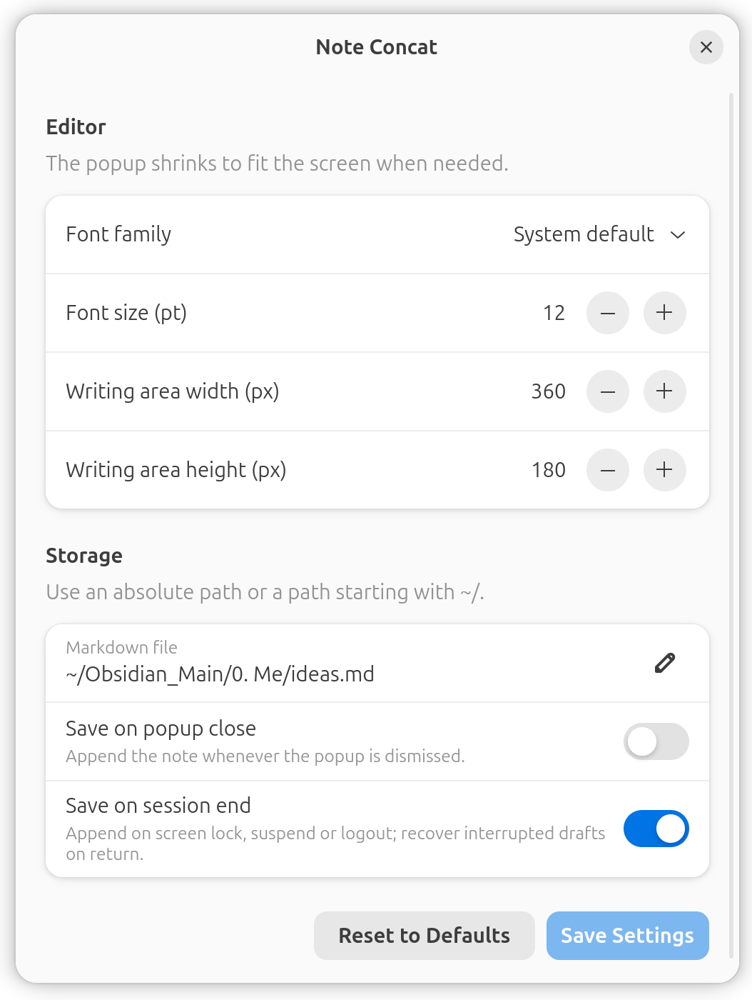
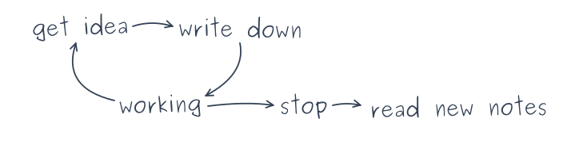

# Note Concat

A minimal GNOME Shell 50 extension for capturing thoughts and appending them to a local Markdown file without losing focus on your current task.

<p align="center">
  
  
</p>

## Motivation

Note Concat is inspired by **distractibility delay**, a technique used in cognitive behavioural therapy for ADHD [[1]](https://pmc.ncbi.nlm.nih.gov/articles/PMC3874265/), and research on **cognitive offloading** [[2]](https://doi.org/10.1016/j.tics.2016.07.002).

> Write down distracting thoughts instead of acting on them. Return to your current task and review them later.

<p align="center">
  
</p>

## Installation

**GNOME Extensions:** [Install Note Concat](https://extensions.gnome.org/extension/12037/note-concat/)

### Manual installation

[Download the latest release ZIP](https://github.com/FreGeh/gnome-note-concat/releases/latest/download/note-concat%40fregeh.shell-extension.zip) or browse [all releases](https://github.com/FreGeh/gnome-note-concat/releases).

Or install directly from the terminal:

```sh
wget -O note-concat@fregeh.shell-extension.zip https://github.com/FreGeh/gnome-note-concat/releases/latest/download/note-concat%40fregeh.shell-extension.zip &&
gnome-extensions install --force note-concat@fregeh.shell-extension.zip
```

### Build from source

From the repository directory:

```sh
gnome-extensions pack --force --extra-source=append.js --extra-source=LICENSE .
gnome-extensions install --force note-concat@fregeh.shell-extension.zip
```

Enable **Note Concat** in Extensions. If it does not appear, log out and back in first.

## Usage

Click the pencil icon in the top panel to write a note. **Save** or **Ctrl+Enter** appends it to `~/Notes/inbox.md` by default (I personally use a note in my Obsidian Vault).

Use the gear button to configure:

- **Editor:** Font and writing area size.
- **Destination:** Markdown file to append notes to.
- **Include timestamps (on by default):** Prefix each note with its local creation time (`YYYY-MM-DD HH:MM`), formatted as an italic Markdown line.
- **Save on popup close (off by default):** Append notes when dismissing the popup. Otherwise, keep the draft.
- **Save on session end (on by default):** Attempt to save when locking, suspending or logging out.

For example, with timestamps enabled the saved Markdown looks like:

```markdown
*2026-11-27 16:58*

Remember to read the paper later.
```

The timestamp records when the note first contains non-whitespace text and is preserved when recovering a draft. Turning the setting off saves notes as plain text without the timestamp. Existing notes are not changed.

Unsaved drafts are stored privately on your device. If a save could not be confirmed, check the destination before retrying.

## License

GPL-2.0-or-later. See [LICENSE](LICENSE).

## References

1. Sprich et al. (2010). [Description and Demonstration of CBT for ADHD in Adults](https://pmc.ncbi.nlm.nih.gov/articles/PMC3874265/). *Cognitive and Behavioral Practice*, 17(1), 9–15.
2. Risko & Gilbert (2016). [Cognitive Offloading](https://doi.org/10.1016/j.tics.2016.07.002). *Trends in Cognitive Sciences*, 20(9), 676–688.
